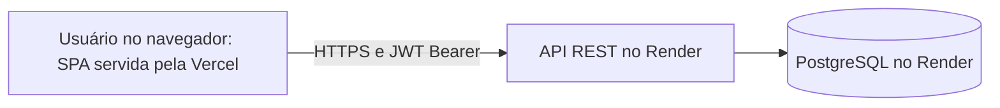

# Arquitetura do Frontend +PraClinic

## 1. Visão geral

SPA de gestão clínica publicada principalmente na Vercel. GitHub Pages permanece como publicação secundária/compatibilidade. Todas as telas funcionais consomem a API REST do backend no Render; o servidor é a autoridade de autenticação, autorização, ownership e persistência.



Produção principal: https://praclinic.vercel.app

Publicação secundária: https://carloseduardofurlan.github.io/GestaoDeClinicas-Frontend-ProjetoFinal-maisPraTi/

API: https://praclinic-api.onrender.com/api

## 2. Stack

React 19/React DOM, TypeScript 5.8, React Router 7, Vite 6, Axios, Tailwind CSS 4, Lucide React, clsx e tailwind-merge. O plugin React e o plugin Tailwind integram o build Vite. Esbuild também é usado pelos smokes.

Bun 1.4.4 e `bun.lock` são a referência de instalação congelada; Node 24 executa os smokes no CI. `package.json` e o lockfile definem as versões efetivas das dependências.

## 3. Estrutura da aplicação

| Diretório | Responsabilidade |
| --- | --- |
| `app` | Router, carregamento de páginas e guards |
| `pages` | Telas e estado dos fluxos funcionais |
| `components` | Formulários, ações de consulta, navegação, modais e elementos de UI compartilhados |
| `services` | Cliente HTTP e operações tipadas por recurso |
| `types` | Contratos request/update/response, sessão e erros |
| `lib` | Sessão, normalização de erros, datas, disponibilidade e derivações de apresentação |
| `config` | Matriz de permissões, navegação e layout |
| `contexts` | Identidade autenticada e notificações |
| `hooks` | Carregamento, cancelamento e refetch de conjuntos de dados |
| `layouts`, `styles` | Shell da aplicação e tokens visuais |
| `public`, `scripts` | Assets estáticos, smokes e validação de deploy |

A aplicação fica na raiz. Não há contexto global de dados de negócio simulados.

## 4. Autenticação e sessão

O login envia e-mail/senha a `/auth/login`, recebe accessToken, armazena-o no localStorage sob `auth_token` e consulta `/auth/me`. Nome, perfil, userId e eventual professionalId vêm dessa identidade real. Senhas não são persistidas pelo cliente.

Ao carregar com token, AuthContext valida `/auth/me` antes de liberar as rotas. Não confia apenas em JWT decodificado localmente. Logout remove token/identidade e remonta as telas dependentes da sessão. Alterações de storage em outra aba também revalidam a identidade. Não há refresh token ou logout remoto no contrato.

401 fora do login limpa a sessão e retorna ao fluxo de login. Um 401 tardio de requisição de uma sessão anterior não encerra uma sessão mais nova. Credenciais incorretas no login geram erro do formulário. Erros de rede/403 durante restauração permitem nova tentativa sem apagar o token; 403 não equivale a logout.

## 5. Rotas e guards

BrowserRouter usa o basename calculado por `import.meta.env.BASE_URL`. SessionGuard protege o shell e aguarda restauração; RouteGuard usa a mesma matriz de perfis do menu, inclusive em URLs diretas. Sem sessão, o usuário vai a `/login`; perfil proibido vê Acesso negado com retorno ao Dashboard.

| Rota | Tela |
| --- | --- |
| `/login` | Login |
| `/` | Dashboard |
| `/appointments` | Agenda |
| `/consultations` | Consultas |
| `/patients` e `/patients/:id` | Pacientes e detalhes |
| `/professionals` | Profissionais |
| `/specialties` | Especialidades |
| `/users` | Usuários |
| `/medical-records` | Prontuários |

URLs desconhecidas mostram a página de rota não encontrada. `/schedules` não é uma tela independente: a disponibilidade é operada pela Agenda.

## 6. Perfis e permissões

| Área | ADMIN | RECEPTIONIST | PROFESSIONAL |
| --- | --- | --- | --- |
| Dashboard | Consultas e pacientes globais | Consultas e pacientes globais | Consultas próprias |
| Users | Gestão de contas | Sem acesso | Sem acesso |
| Specialties | Gestão | Leitura | Leitura |
| Professionals | Gestão | Leitura | Sem cadastro global |
| Patients/Details | Ler, criar e editar | Ler, criar e editar | Sem acesso global |
| Schedule na Agenda | Criar para qualquer profissional | Leitura | Criar próprios |
| Agenda/Consultas | Gestão e transições válidas | Agendar, confirmar e cancelar | Ler, iniciar e concluir próprios |
| MedicalRecords | Leitura global | Sem acesso | Ler, criar e editar próprios |

PatientDetails expõe registros clínicos somente ao ADMIN. A UI oculta ações, os handlers verificam perfil e RouteGuard protege rotas; o backend continua a autoridade final. professionalId da sessão orienta a UX, sem substituir a verificação de ownership no servidor.

## 7. Services e cliente API

Uma instância Axios central usa `VITE_API_URL` como base, JSON e timeout de **120.000 ms**, para acomodar cold starts de ambientes hospedados. Não há retry automático, polling de disponibilidade ou keepalive.

O interceptor adiciona Bearer nas chamadas autenticadas, sem enviar token antigo ao login. Services retornam DTOs tipados e recebem AbortSignal quando aplicável. HTTP fica nos services; páginas usam seus métodos. Listagens são arrays; filtros e contagens são locais, sem paginação ou parâmetros de API inventados.

## 8. Módulos e fontes de dados

| Módulo | Recursos backend |
| --- | --- |
| Dashboard | Appointments; Patients somente para ADMIN/RECEPTIONIST |
| Users | `/users` |
| Specialties | `/specialties` |
| Professionals | `/professionals` e `/specialties`; criação inclui User/Address no mesmo request |
| Patients | `/patients`, com Address aninhado |
| PatientDetails | `/patients/{id}`, Appointments e, para ADMIN, MedicalRecords |
| Agenda | `/schedules` e `/appointments` |
| Consultas | `/appointments`, `/schedules` e `/statuses` |
| MedicalRecords | `/medical-records` e `/appointments` |

Edição de User exige uma nova senha e não altera o e-mail de login. Edição de Professional não altera conta/senha/perfil. Patient preserva CPF na edição; não há botão ou método de exclusão de paciente. UUIDs vêm da API.

## 9. Fluxos principais

### Disponibilidade e consultas

Schedule é disponibilidade; Appointment é a consulta. Agenda e Consultas são duas visualizações do **mesmo Appointment**, com os mesmos UUIDs. Não existe entidade ou API independente de Consultation.

Uma disponibilidade fica livre quando não há Appointment diferente de Cancelada para profissional/data/hora. Consultas concluídas continuam ocupando o slot; canceladas permanecem no histórico e liberam nova reserva. O cálculo local é apenas apresentação: a reserva é confirmada pelo backend.

O mesmo AppointmentFormModal atende Agenda, Consultas e PatientDetails; no detalhe do paciente, ele é pré-selecionado e fixo. O status inicial não é enviado: o backend atribui Agendada. Transições usam statusId do catálogo real. Cancelamento exige confirmação e DELETE lógico; após 204, o cliente recarrega os dados e mantém o histórico visível.

ADMIN executa transições válidas; recepção confirma e cancela; profissional inicia/conclui consultas próprias. Concluída e Cancelada são finais. Datas clínicas permanecem YYYY-MM-DD e horários mantêm precisão de LocalTime, sem conversão de payloads para UTC. A navegação Dia/Semana usa calendário local com sete dias.

### Prontuários e detalhes

MedicalRecord possui `id`, `appointmentId` e `notes`. A criação envia appointmentId/notes; a edição envia somente notes. A UI relaciona o registro ao Appointment por UUID para exibir paciente, profissional, data/hora e status, sem ampliar o DTO com campos clínicos estruturados.

PROFESSIONAL seleciona consultas próprias sem prontuário. Não se acrescenta exigência de status Concluída. ADMIN lê; RECEPTIONIST não acessa conteúdo clínico. Não há exclusão de prontuário.

PatientDetails lê o paciente pelo ID da URL. A aba Consultas filtra os Appointments pelo patientId; Registros Clínicos relaciona MedicalRecord/Appointment e filtra o mesmo paciente. Referências indisponíveis são informadas sem fabricar identidade.

### Dashboard

Indicadores são calculados a partir dos arrays autorizados, sem endpoint `/api/dashboard`: consultas do dia local, próximas consultas sem Cancelada/Concluída e total de pacientes quando permitido. PROFESSIONAL não consulta Patients globais nem recebe esse total. O relógio visual se atualiza localmente; isso não é polling da API.

## 10. Estado e dados

Estado de tela/formulário usa hooks React. AuthContext mantém identidade, e ToastContext mantém notificações transitórias. sessionVersion provoca descarte das telas quando a sessão muda.

Hooks carregam conjuntos dependentes de forma conjunta: Schedule/Appointment para disponibilidade; MedicalRecord/Appointment para prontuários; Appointment/Patient quando o Dashboard precisa de ambos. Falha em uma fonte não apresenta uma visão parcial como completa. Requests anteriores são abortados ao atualizar/desmontar quando previsto pelo fluxo.

Depois de mutações, listas usam a resposta real ou refetch. Pending e travas de operação impedem envios duplicados; sucesso só é mostrado após confirmação HTTP. Não há cache global de negócio persistido entre sessões.

## 11. Erros e recuperação

ApiError preserva `timestamp`, `status`, `error`, `message`, `path` e `details`. A UI tem loading, empty states, mensagens de erro e atualização manual. 400 apresenta validação; 401 invalida a sessão; 403 preserva o login; 404 informa inexistência; 409 informa conflito; timeout e rede possuem mensagens próprias.

Erros de gravação preservam o formulário e os dados digitados. Em conflitos de disponibilidade ou unicidade clínica, o refetch remove opções ocupadas e impede novo envio inválido. As novas tentativas ocorrem por ação do usuário, sem retry automático.

## 12. Performance

As páginas usam React.lazy e Suspense; Vite preserva chunks de páginas e dependências comuns. Após a autenticação e montagem do shell, `requestIdleCallback` antecipa somente chunks permitidos ao perfil, sem chamadas à API; dois frames de `requestAnimationFrame` são o fallback cancelável. Guards e matriz de permissões permanecem os mesmos. O favicon é um SVG local referenciado com a base do build.

`useDelayedLoading` e `DelayedLoading` exibem indicadores de sessão, rota e dados somente após **250 ms**. O threshold elimina flashes de respostas rápidas e mantém feedback em operações lentas, sem atrasar requests, navegação ou impor tempo mínimo. O fallback acompanha a resolução do chunk, evitando que a retenção do Suspense produza um flash após a importação já ter terminado.

`LoadingContent` distingue primeira carga de refresh na montagem atual: não mostra empty state antes da resposta e mantém conteúdo já carregado durante atualização, com feedback discreto após o mesmo threshold. Os GETs continuam em cada montagem/refetch, erros aparecem normalmente e escritas mantêm pending/disabled imediato. Não foi necessário cache global de dados; o backend continua a fonte de verdade.

## 13. Responsividade e acessibilidade

Menu lateral desktop e menu mobile em dialog nativo; navegação filtrada por perfil e fechamento ao navegar. Tabelas e grade possuem scroll horizontal local; o shell permite redução de largura sem provocar overflow do documento.

Modais usam showModal, conteúdo externo inerte, foco inicial em campo habilitado, retorno ao acionador, Escape e navegação de teclado. Títulos/descrições usam aria-labelledby/describedby; labels, nomes acessíveis, estados aria, foco visível, skip link e reduced-motion apoiam a navegação. PatientDetails usa tabs com setas/Home/End. Essas escolhas não equivalem a certificação WCAG.

O Spinner funcional usa `1s linear infinite` no modo normal e `1.5s linear infinite` com movimento reduzido. A exceção é localizada em `.app-spinner`; a regra global de reduced-motion continua aplicada ao restante da UI.

## 14. Configuração

`VITE_API_URL` é pública e definida no build; produção usa `https://praclinic-api.onrender.com/api`. Nunca colocar credenciais em variáveis VITE_*.

Localmente, `.env.local` ignorado pode definir a API local. Vite deve ser reiniciado após alterações. O script dev usa `http://localhost:3000` com strictPort. Configure a origem local somente no backend local correspondente. Em produção, CORS permite exatamente `https://praclinic.vercel.app` (principal) e `https://carloseduardofurlan.github.io` (secundária), sem wildcard, caminho do repositório ou barra final.

## 15. Build, testes e CI

```sh
bun install --frozen-lockfile
bun run lint
bun run build
bun run smoke
node scripts/smoke-agendamentos.mjs
node scripts/smoke-clinica-dashboard.mjs
```

`lint` é TypeScript (`tsc --noEmit`), não ESLint. Smokes usam Node/assert/esbuild e HTTP isolado: verificam contratos do cliente, sessão/erros e derivações de calendário/clínica/Dashboard, sem produção ou credenciais reais. Não substituem teste de browser/backend reais.

**Frontend validation** executa instalação congelada e esses gates em PRs para develop/main, pushes em develop e execução manual. O lockfile oficial é bun.lock.

## 16. Deploy do frontend

### Vercel — produção principal

O projeto `praclinic` publica automaticamente a **main** (Production Branch), com preset **Vite**, Root Directory `./`, Install Command `bun install --frozen-lockfile`, Build Command `bun run build` e Output Directory `dist`. `VITE_API_URL=https://praclinic-api.onrender.com/api` é configurada somente no ambiente **Production** da Vercel; não contém credenciais.

A base do build é `/`. `vercel.json` fornece o fallback SPA para `/index.html`, preservando assets e permitindo acesso direto/F5 em rotas como `/appointments` e `/patients`. A API continua acessada diretamente no Render pelo navegador.

### GitHub Pages — publicação secundária

O workflow **Deploy to GitHub Pages** responde a push em main ou disparo manual. Pages usa Source = GitHub Actions. O environment `github-pages` fornece `VITE_API_URL` como variável normal.

O workflow valida a configuração pública, instala com lock congelado, executa gates, gera o build, copia index.html para 404.html e publica o artefato Pages. A base calculada no Actions inclui `/GestaoDeClinicas-Frontend-ProjetoFinal-maisPraTi/`.

Em rota profunda, GitHub Pages responde o documento 404.html com HTTP 404, mas ele contém a SPA; BrowserRouter resolve a tela e a restauração da sessão. Esse status do documento é distinto de erro de asset/API. Assets, favicon e chunks devem usar a base correta e carregar normalmente.

## 17. Integração e operação

Assets são servidos principalmente por `praclinic.vercel.app`, ou por `carloseduardofurlan.github.io` na publicação secundária; requisições de negócio usam `praclinic-api.onrender.com/api`. O backend permite exatamente essas duas origens HTTPS, sem wildcard ou caminho do repositório. Bearer é enviado em headers, sem cookies de sessão.

O serviço hospedado pode sofrer cold start. O timeout de 120 segundos não garante resposta em todos os cenários; ao expirar, a UI informa o problema e permite tentativa manual. Tokens, senhas e respostas sensíveis não devem ser gravados em relatórios, screenshots, traces ou Git. Dados HML/FICTÍCIO são identificados como descartáveis e não representam atendimento real.
